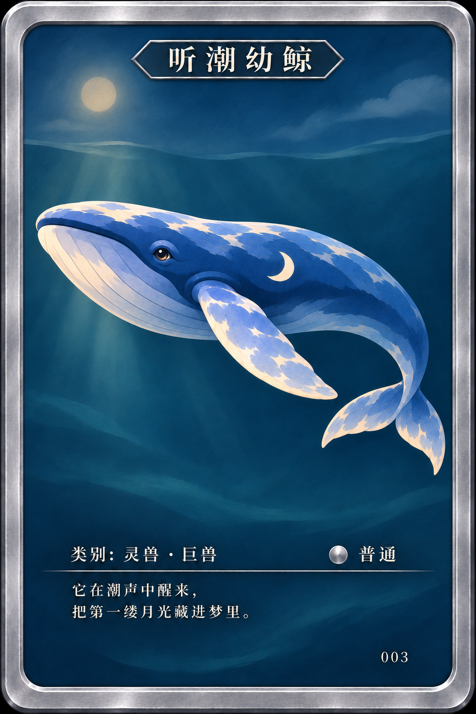
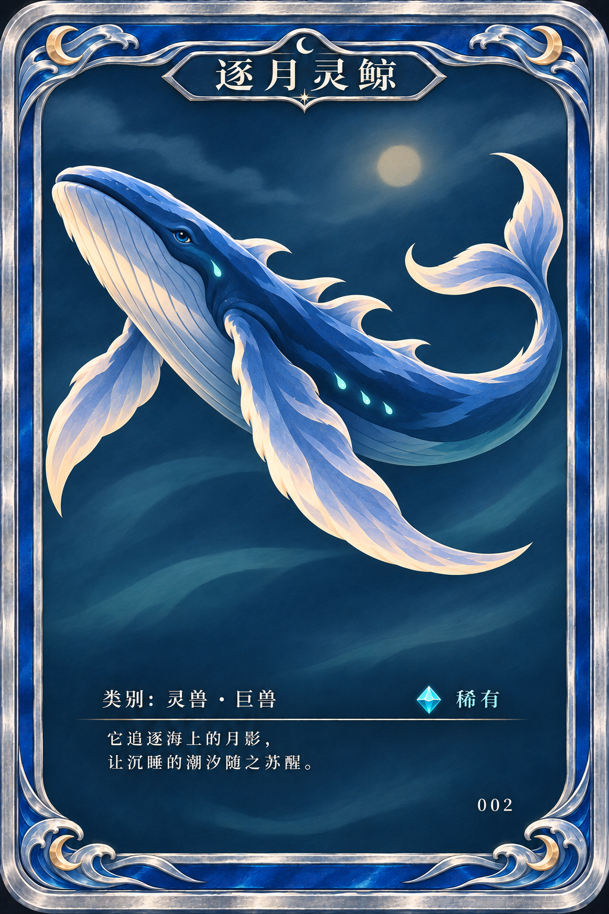
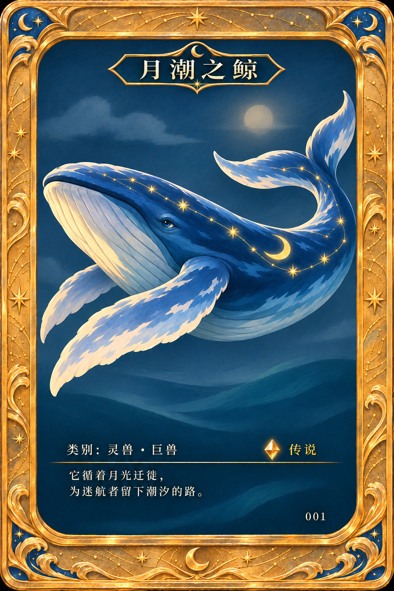

# A16 美术文档

本文件是项目视觉设计与美术制作要求的唯一现行正文，独立于 [项目文档](PROJECT.md) 维护。更新时间：2026-11-25。

维护范围包括画风、卡面布局、品质视觉、效果稿与制作成本。卡牌字段、类别、系列归属和收藏身份规则以 [卡牌信息规范](PROJECT.md#cards) 为准；资产选择状态只在 [资产登记](../.project/artifacts.json) 维护。历史原型说明不覆盖本文件。

## 已确认方向与未确认选择

采用二维卡面、三维桌面，固定倾斜视角已得到用户试玩认可。桌面应承托卡片，插画是主要观看对象。用户明确否定当前原型美术品质，并要求以《TCG Card Collection: Tidy Up》为品质参考；这不授权复制其资产。

已确认全幅插画布局、加宽边框、强化品质区别、淡化背景细节突出核心单位。用户随后要求尝试宫崎骏／吉卜力方向的画风，已有手绘动画感研究稿；**要求尝试不等于最终选定画风**。写实奇幻与手绘方案的商业取舍尚未完成。

## 卡面布局

采用用户选择的 **B：全幅插画式卡面**。名称、品质、类别、简短背景文案和编号的排版服从项目文档中的字段规则，以边框和信息底衬保证辨认。具体字号、尺寸、间距和最终字体尚未锁定。

## 已确认玩法带来的资产约束

Steam Windows PC、键鼠、简体中文为当前范围。第一人称收藏室与固定倾斜工作台需要一致的视觉体验。拼图切为 2×3 共 6 片、矩形网格凹凸咬合，外轮廓平直。正反面随机且可翻面，碎片背图应与原卡背对应；污渍允许只覆盖部分碎片，清理后显露原画。

这些约束的权威来源为 [项目玩法规则](PROJECT.md#gameplay)，不表示最终画风、模型、贴图或材质已获批准。验证版数量为 2 系列 12 卡，具体正式卡表仍需内容批准。

## 当前画面要求

- 核心单位轮廓清晰，有容易辨认的脸、肢体或标志纹样；缩小到桌面尺寸也能识别。
- 背景降低对比与细节密度，用月光、海面、云层等建立情绪。避免月亮、浪花、星光抢走主角。
- 手绘方案可使用柔和笔触、透明水彩或不透明水粉的色层、温暖生命感；不依赖临摹具体作品角色。
- 边框明显宽于早期细框，但不吞掉插画主体；文字有独立可读的底衬，卡面布局跨品质保持稳定。
- 每张卡要有可辨认的碎片局部。简化背景后需重新切成六片试玩，防止出现多个近乎相同的空白块。

## 品质表达方案（效果稿方向，生产数值待定）

| 品质 | 视觉层级 | 材质方向 |
| --- | --- | --- |
| 普通 | 较朴素的宽银框，装饰克制 | 缎面纸与少量金属边 |
| 稀有 | 蓝色珐琅与银色双层框，月潮装饰 | 局部光泽与更明显的层次 |
| 传说 | 宽金框、多层结构、星图浮雕，角部装饰更完整 | 局部箔面、压纹与随视角变化的高光 |

品质差异应在正常游玩距离可见，不只依靠品质名与小图标。仍保留文字与符号便于识别。工艺本身不加文字标签，不产生同名同图的收藏变体。动态箔面、浮雕、纸张厚度都需要引擎内样板，不能用静态图中的闪光证明已经实现。

## 当前保留素材与状态

当前只保留 Godot 使用的三张主体突出效果稿、系列卡背、四份原始提示词和来源清单。图片直接作为 Godot 运行资源，避免再维护浏览器目录中的重复母源。路径、选择状态与 SHA-256 以 [资产登记](../.project/artifacts.json) 为准。

[系列卡背](../godot/assets/back.png) · [提示词与来源清单](../godot/assets/source/manifest.json)

图稿仍是扁平 PNG，文字、插画和边框尚未拆成生产图层，不能当作分层母版、法线图或材质遮罩。Godot 使用和用户试玩通过，不改变最终画风与素材仍待审阅的状态。未采用的旧探索稿已从当前项目清理，可按 Git 历史查阅。

## 制作成本如何验证

建议先完成一张传说卡的生产样板，再做一张低品质卡作为对照，记录以下实际工时和返工次数：形象设计、插画修整、背景拆分、框体与排版、字体验证、材质遮罩、引擎接入、碎片试玩和最终检查。把可复用框体与逐张插画成本分开统计。

生产资产建议拆分为主体／背景／边框／文字与图标／材质遮罩；具体尺寸、色彩空间、透明边、压缩规格和文件命名在引擎选型后确定。字体授权、生成素材使用条件和人工修改来源需登记，不把一张概念图等同于完整权利清单。

早期矢量样板工期不作为当前商业美术报价。当前没有获批预算或交付日期。下一轮以实测工时评估「一张新增卡」和「新增一个系列」的边际成本。

## 维护与待定范围

修改美术风格、框体、材质或制作流程时更新本文件；修改卡牌身份或印刷字段规则时更新项目文档对应章节。效果稿仅用于视觉审阅，最终画风、生产图层、字体授权及实际制作预算仍待确认，不因拆分文档而改变审批状态。

房间收集、工作台处理与入册的玩法范围已确认，但收藏室整体场景风格、收集容器外观及清理工具造型尚未确定。现有桌面样板不能直接作为整个收藏室的最终美术标准。

当前 Godot 直接使用工程内保留素材，没有生成新卡图。素材与提示词迁移已核对完整性，图稿仍未批准为最终生产稿。三维渲染和用户试玩通过不等于商业美术或多硬件性能验收。
