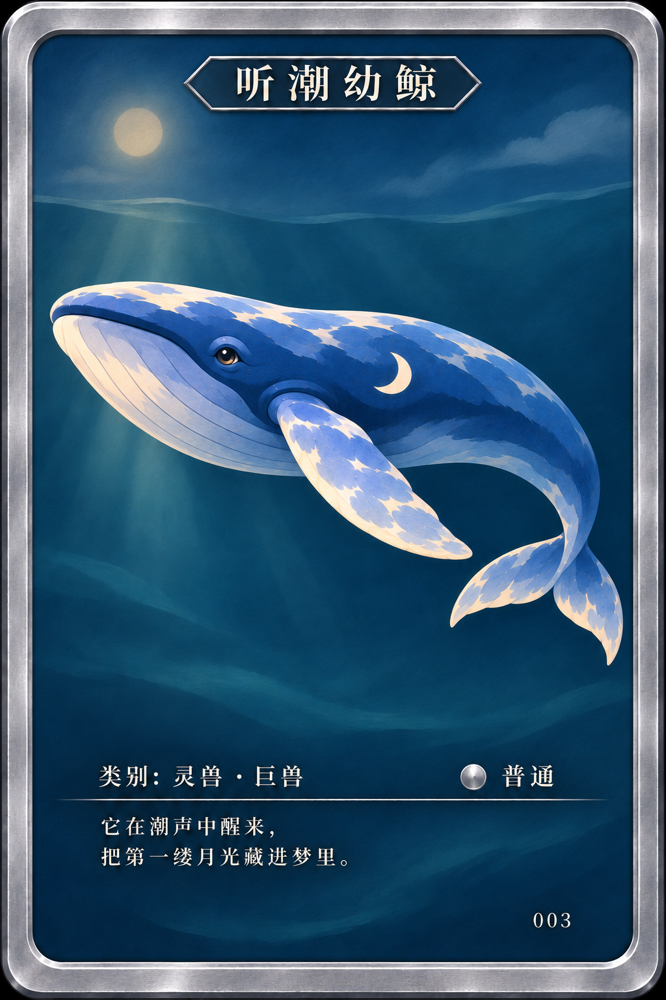
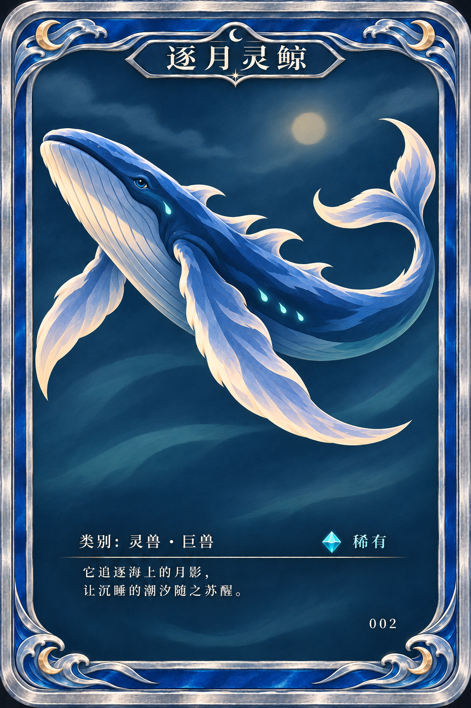
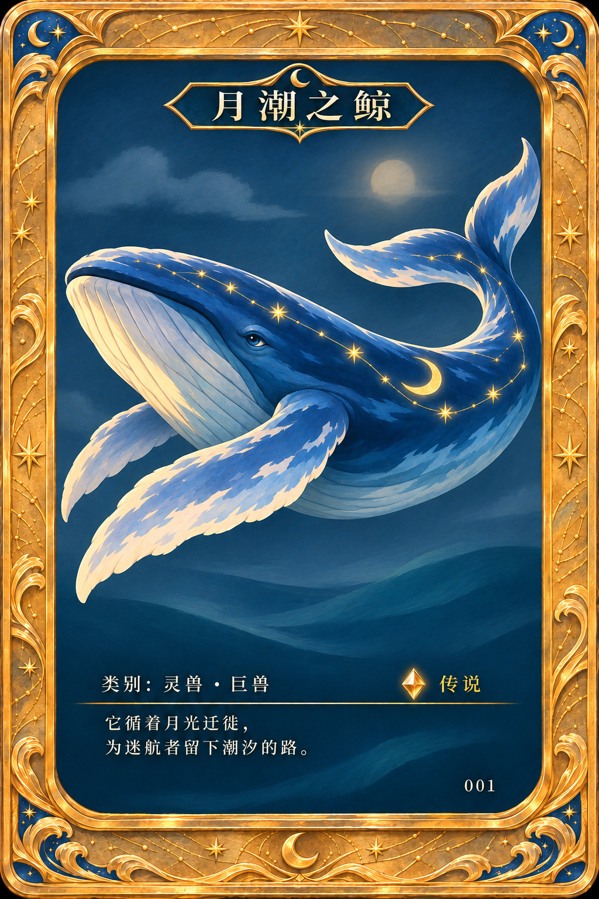

# 美术方向与制作验证

## 已确认方向与未确认选择

采用二维卡面、三维桌面，固定倾斜视角已得到用户试玩认可。桌面应承托卡片，插画是主要观看对象。用户明确否定当前原型美术品质，并要求以《TCG Card Collection: Tidy Up》为品质参考；这不授权复制其资产。

已确认全幅插画布局、加宽边框、强化品质区别、淡化背景细节突出核心单位。用户随后要求尝试宫崎骏／吉卜力方向的画风，已有手绘动画感研究稿；**要求尝试不等于最终选定画风**。写实奇幻与手绘方案的商业取舍尚未完成。

## 当前画面要求

- 核心单位轮廓清晰，有容易辨认的脸、肢体或标志纹样；缩小到桌面尺寸也能识别。
- 背景降低对比与细节密度，用月光、海面、云层等建立情绪。避免月亮、浪花、星光抢走主角。
- 手绘方案可使用柔和笔触、透明水彩或不透明水粉的色层、温暖生命感；不依赖临摹具体作品角色。
- 边框明显宽于早期细框，但不吞掉插画主体；文字有独立可读的底衬，卡面布局跨品质保持稳定。
- 每张卡要有可辨认的碎片局部。简化背景后需重新切成六片试玩，防止出现多个近乎相同的空白块。

## 品质表达方案（效果稿方向，生产数值待定）

| 品质 | 视觉层级 | 材质方向 |
| --- | --- | --- |
| 普通 | 较朴素的宽银框，装饰克制 | 缎面纸与少量金属边 |
| 稀有 | 蓝色珐琅与银色双层框，月潮装饰 | 局部光泽与更明显的层次 |
| 传说 | 宽金框、多层结构、星图浮雕，角部装饰更完整 | 局部箔面、压纹与随视角变化的高光 |

品质差异应在正常游玩距离可见，不只依靠品质名与小图标。仍保留文字与符号便于识别。工艺本身不加文字标签，不产生同名同图的收藏变体。动态箔面、浮雕、纸张厚度都需要引擎内样板，不能用静态图中的闪光证明已经实现。

## 效果稿演进与选择状态

完整路径与状态以 [.project/artifacts.json](../.project/artifacts.json) 为登记入口。

| 阶段 | 含义与限制 |
| --- | --- |
| B 初稿 | 确认全幅布局的研究，仍有旧系列、属性和分母字段，已被覆盖 |
| B 信息修订稿 | 删除旧字段后的单卡审阅稿；配系列徽记卡背，非最终定稿 |
| 品质第一组 | 不同鲸形态与普通／稀有／传说对照 |
| 加宽边框组 | 更宽边框与更明显品质的对照 |
| 手绘风格组 | 尝试手绘动画、水彩水粉质感 |
| 主体突出组 | 最新待审阅组，降低背景细节；尚未获最终批准 |

这些图片是合成的扁平 PNG 效果稿，文字、边框、插画尚未拆成生产图层，也未接入原型。不能将其直接登记为可编辑母版、法线图、金属度贴图或可发布素材。旧目录 `current.json` 仅记录此前单卡审阅状态，不代表全项目最新或最终批准。

## 制作成本如何验证

建议先完成一张传说卡的生产样板，再做一张低品质卡作为对照，记录以下实际工时和返工次数：形象设计、插画修整、背景拆分、框体与排版、字体验证、材质遮罩、引擎接入、碎片试玩和最终检查。把可复用框体与逐张插画成本分开统计。

生产资产建议拆分为主体／背景／边框／文字与图标／材质遮罩；具体尺寸、色彩空间、透明边、压缩规格和文件命名在引擎选型后确定。字体授权、生成素材使用条件和人工修改来源需登记，不把一张概念图等同于完整权利清单。

历史 `ART-DIRECTION.md`、`3D-STUDY.md` 的工期是早期矢量样板假设，不能作为当前商业美术报价。当前没有获批预算或交付日期。下一轮以实测工时评估「一张新增卡」和「新增一个系列」的边际成本。
